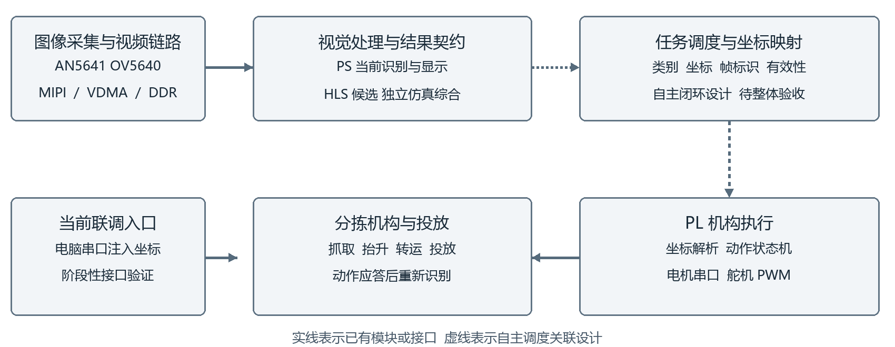
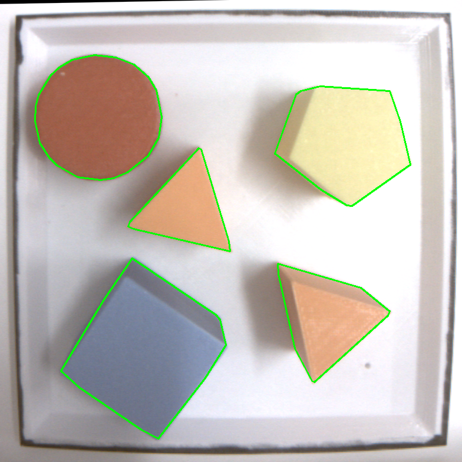

# 基于 Zynq PS PL 协同的视觉引导分拣装置

竞赛提交设计报告  2026 年 11 月 4 日工程快照

本项目面向规则物体的桌面分拣，采用相机感知、嵌入式视觉、任务调度与可编程逻辑执行的分层架构。系统目标是从图像提取物体类别和抓取坐标，驱动机械机构完成抓取、转运与分类投放，并在动作结束后重新感知。本文给出总体设计、当前实现、HLS 加速候选、验证证据以及可供其他队伍复用的技能。

### 交付结论与阅读范围

本包以 11 月 4 日恢复的原控制整合版本为主线，冻结配套 bit、HDF、ELF、BOOT 与控制源码。历史上已验证图像链路和指定坐标抓放；HLS 颜色核完成独立验证。完整自主分拣仍须完成视觉结果直接调度机构的端到端验收。文中的“设计功能”“独立候选”“历史板测”分别对应其证据层级。

| 对象 | 当前可核实结论 |
| --- | --- |
| 整合原控制基线 | 11 月 3 日两次人工坐标注入抓放；第一轮同时确认 HDMI 画框 |
| 11 月 4 日恢复 | Flash 回读一致、JTAG 下帧前进；未重新确认冷启动或抓放 |
| HLS 颜色核 | 16 个 host 案例、6 个 RTL 事务；尚未整合上板 |
| 工程与技能打包 | 源码依赖、构建入口、真实证据及离线校验已整理 |

报告与根 README 为当前状态入口。原始日志和历史笔记保持原事实，若叙述时间不同，应按对应版本与具体试验判断，不能把多个阶段的成功条件合并为一次整机验收。

## 1 选题背景与总体方案

小批量物料分拣需要同时解决外观感知、空间定位与动作执行。单纯依赖预设坐标难以适应物体位置变化；把全部视觉计算放在处理器上，又会引入重复像素遍历、访存与显示叠加开销。Zynq 的 PS 与 PL 为算法快速迭代和确定性数据处理提供了协作基础。



系统采用 AX7Z020B 开发板，目标器件 xc7z020clg400-2，工具链为 Vivado、SDK、HLS 2019.1。AN5641 相机模块配合 OV5640 传感器，经 MIPI 接收和视频链路进入 DDR，显示侧输出 HDMI。PS 承担配置、当前视觉检测和显示组织；PL 组织采集、视频接口及机构控制。

扩展板负责舵机 PWM、电机通信和电源连接；机械部分完成抓取、抬升、转运和投放。工作区没有检出可交付的扩展板 PCB 或机械 CAD，不推测其电压、电流额定值和尺寸。实际接线须依据 XDC、板卡资料和实物核对。

创新主要体现在面向真实黑边区域的感知约束、实例成员像素的精确颜色投票、帧与动作任务的一致性契约，以及把工程失败转化为可运行的校验技能。其价值以具体实现和验证范围解释，不把成熟视频参考链路作为原创贡献。

## 2 视觉识别方法与软硬件划分

识别场景为白色约 16 cm 方形工作区，物体涉及红、橙、黄、绿、蓝及圆柱、三棱柱、五棱柱、立方体。当前整合基线主要使用 PS 传统视觉：720p 图像链路中以 640×360 检测视图处理，依据实际黑边确定运行 ROI，结合整数颜色规则、形态学开运算、支持域、8 连通域和侧面合并形成对象。

处理流程首先限定有效工作区域，再提取前景与候选分量；合并同一物体的可见部分后，输出位置、边框及外观属性。动态 ROI 能减少固定框与实物场地偏移的耦合，但 ROI 失效时必须停止生成可执行任务。Python 和 PS 中的形状判别为有限视角启发式，尚不能表述为经验证的三维形状识别。

| 方面 | PS 传统视觉基线 | HLS 至 PL 候选 |
| --- | --- | --- |
| 运行方式 | 处理器顺序循环与 DDR 访存 | 按数据流建立并行和流水计算 |
| 适合职责 | 策略、配置、调试、显示与调度 | 规则固定且重复率高的像素计算 |
| 接口代价 | 已有相机缓冲与软件结构 | 须补齐帧协议、存储、搬运与错误处理 |
| 性能依据 | 指定历史场景的实测窗口 | 综合周期、II 和资源估计 |
| 本包完成度 | 当前整合镜像的主要检测路径 | 独立核已验证，完整链路待整合 |

划分依据是存储生命周期、数据复用、并行机会和接口开销，而非“全部迁移必然更快”。PS 保留高层控制，PL 承担稳定数据路径；每次迁移都先证明数值与协议等价，再评估系统资源与端到端时延。

## 3 HLS 颜色核与优化结果

选定候选来自 20261018_021715_hls_2cefcb0f。颜色核使用最终实例的成员关系映射，只让被接纳的对象像素参与投票，避免边框内部背景和被丢弃分量污染颜色。输入采用明确的 BGR 字节序，HSV 的整数倒数表与舍入规则与 OpenCV uint8 参考一致。

成员包先于光栅输入，输出按 slot 和不可变 frame token 关联最终几何结果。计算并行比较色相距离，通过比较树选择类别，投票存储采用共享双口直方图。固定规则的颜色相互排斥，复制五组计数存储不能自动提升像素吞吐。该核始终输出 shape=UNK，不从颜色推断形状。

| 指标 | 早期记录 | 选定候选 |
| --- | --- | --- |
| LUT 估计 | 2877 | 2678 |
| FF 估计 | 2335 | 1906 |
| BRAM18 / DSP | 按对应原报告查看 | 2 / 2 |
| 时钟与光栅 II | 不作整机对比 | 目标 10 ns；估计 8.321 ns；II=2 |
| 验证范围 | 历史迭代 | host16、RTL6、导出；未整合上板 |

按表中同单位记录直接计算，LUT 减少约 6.9%，FF 减少约 18.4%。早期笔记另载 12.8% 和 21.8%，与此组前后值不一致，本报告不采用该百分比。上述值来自 HLS 估计和历史记录，不是布局布线资源或实测 FPS。

confidence 是有效颜色票中获胜颜色的比例，不是校准概率；高 confidence 伴随低有效覆盖仍不能放行抓取。独立 OpenCV/NumPy oracle 覆盖历史图像、随机像素、多部分对象、空场景、平票、暗色与协议错误；样例等价证明的是实现一致性，不能替代现场识别准确率。

## 4 机械执行与视觉联调接口

机构侧把平面坐标转换为底座角度及直线运动参数，按状态机组织接近、抓取、抬升、投放与返回。底座和夹爪由 PWM 控制，两路电机通过串口链路通信。当前整合顶层以 100 MHz 驱动原控制逻辑，独立历史原版采用 50 MHz，两者不得直接替换。

### 任务契约与握手

接口流程为坐标命令 (x,y) → 等待 0 OK → 发送仓号 → 等待 N OK。自主模式的设计要求是：视觉结果与 ROI、类别、坐标变换、帧标识共同组成一个任务；一次只放行一个有效任务，动作应答完成后重新识别。超时、未知类别、混帧、坐标超界或 ROI 丢失都应使任务失效。

目前联调以电脑串口注入坐标，验证与未来视觉调度相同的坐标入口。11 月 3 日记录了两次 (0,0) 到 1 号盒的真实抓放，应答为 0 OK 和 1 OK。此结果覆盖指定坐标的执行与握手，尚未覆盖视觉自动发出坐标的整条闭环。当前 camera_claw_top 的 pc_rx/pc_tx 仍是外部控制端口。

### 标定与机械边界

原 1/1/ceshi 映射保持锁定，不用修改映射掩盖物理偏移。恢复前差分比较中三版本各完成 354 个断言，输出 183 个电机包与 5760 个舵机事件，忽略时间戳后轨迹一致；这不能证明实际位置误差为零。READY 定时标志也不能等同物理回零。

六盒映射、更多场景、全坐标域偏差及异常恢复仍须实测。skill/vision-motion-contract 给出像素至机械坐标的离线契约预览，示例参数必须替换为真实标定；脚本不会发送运动命令。

## 5 实现资源与时序审查

build/reports/integrated_route 保存 11 月 2 日原控制整合版的路由报告，板端配套产品沿用 11 月 3 日快照并于 11 月 4 日恢复。下表按原路由报告记录资源和时序。修复分支的报告放在技能负例中，单独标明版本。

| 项目 | 历史原控制整合报告 | 解释 |
| --- | --- | --- |
| LUT | 21208 / 53200  39.86% | Routed 状态 |
| FF | 27530 / 106400  25.87% | Slice Registers |
| BRAM tile | 22 / 140  15.71% | 与 BRAM18 单位分开 |
| DSP | 54 / 220  24.55% | 整合视频链路等资源 |
| Setup WNS | −0.247 ns | 全局仍失败 |
| Hold WHS | −1.111 ns | 全局仍失败 |

控制域 100 MHz、视频与采集时钟应按 clocks.rpt 逐项审查，不能用单一“主频”代表整机。负 setup/hold 以及相机 CDC 问题仍需处理，不可通过掩盖约束获得表面通过。工具完成、局部关键域改善和全局签核分别报告。

历史十一核独立资源简单相加为 54201/53200 LUT、273/280 BRAM18，尚未计算父适配等逻辑，LUT 已超预算。因此 HLS 整合必须共享存储与传输、裁剪并发实例，随后重新实现；不能据各核可综合断言整机能直接装入。

工程所需的 265 个 IP-XACT 文件引用已核对。build/create_project.tcl 从包内源码、BD 和 IP 创建新工程，并可执行完整综合实现。迁移后的入口已做离线检查，尚未重新跑完全量原生构建。

## 6 功能验证与历史场景材料

验证按离线算法、RTL 仿真、实现报告、镜像配套、板级行为逐层记录。sim/hls_object_color 是独立颜色核真实报告；sim/calibration/comparison 是恢复前控制差分；board/evidence 按日期保存现场与工具记录。每一结论只覆盖其输入、版本和观察窗口。



10 月 14 日的历史 PS 测试中，4 目标窗口约 10 FPS，6 目标窗口约 7.5 FPS。两组验收记录、帧率采样与逐像素比对保存在 board/evidence/historical_ps。它们对应当时的软件和场景，当前恢复整合版及 HLS 整机加速比需要另行测量。图中绿色轮廓是历史离线参考输出，不作为人工像素金标。

11 月 4 日恢复记录中 objects=0、ROI mode=0，串口 STATUS 接收为 0 字节，未发运动命令。Flash 回读一致和帧前进支持产品恢复与程序运行，不支持当日识别正常、实屏画框或新抓放已经确认。展示素材可用 data 中历史场景图，必须配“离线参考输出”或对应当日来源标签。

## 7 大模型协作方式与真实记录

协作采用需求拆解、候选实现、确定性验证、反证与修正、证据冻结的迭代流程。模型用于分析算法划分、生成可审查代码、定位工具与协议问题、整理报告；原始日志、黄金参考和人工实物观察承担验收。本文没有虚构多智能体调度记录，也没有用未测量的节时百分比评价收益。

### 真实提示词片段

D05，2026 年 10 月 24 日，用户要求“将代码时序收敛，拿到板极验证的结果”。后续 D06 保存了候选被拒绝的判断，因此这条需求不能写成全局时序已经通过。

D08，2026 年 10 月 29 日，用户提出“因为进度原因，我想先实现还没有迁移到pl端的视觉加上抓取”。这一记录说明阶段目标从全面迁移调整为现有视觉与执行联调，报告应据最终实现重写。

D11，2026 年 11 月 3 日，用户要求按自主分拣目标组织文档，并说明当前机械验证暂用电脑串口注入。D12 对应将总体设计与阶段验收分开表述，避免把接口注入试验写为自主闭环。

### 模型回答与证据的对应规则

report/collaboration/records 新增77条真实消息，来自38个需求或现场反馈窗口，带角色、UTC时间、会话文件名、行号、字符区间及SHA256；原9段摘录继续保留。22份工程证据见skill/evidence。扩充Word及Markdown含26项复盘，覆盖算法、HLS、时序、机械联调与标定纠错。

完整原文见history_transcript.md/.jsonl；来源索引见history_index.json。缺失提示词明确注明，不虚构问答。reconstructed_examples.md另列8套事后提炼模板；模型上下文不能用当前模型反推，也不将旧版本验收继承给恢复版。

## 8 模型纠错轨迹与可验证反证

### 容量判断的修正  C01

早期模型回复 D02 曾概括部分特征图超过片上 BRAM。E19 的字节预算显示：器件 140 个 BRAM36 对应理想容量 645120 字节；观察到的最大 INT8 特征图 409600 字节单独可容纳，而 2937564 字节权重约为总量的 4.55 倍。修正后的规则是按同时存活缓冲、权重和系统保留预算，不能从单个张量大小推出整网适配结论。

### RTL 报告与旧收据冲突  C02

E06 摘要把 RTL cosim 写为失败，真实 E07 表中 Verilog 为 Pass、延迟 231181 周期。E09 说明旧 runner 只在 stdout 寻找表而漏读报告文件。修正方案是读取真正的 RTL 表，保留原收据并标记矛盾。当前 inspect_hls 的真实冲突用例返回非零，防止把旧状态静默改成成功。

### 文件存在但工具报错  C03

D04 记录 builtin.tcl 实际存在而工具仍报 No error，先保持根因未定。D03 与 E10 后续通过最小对照，把问题定位为 Windows 句柄复用与 Tcl 旧通道冲突；管道承接标准通道、父进程持续采集日志后恢复构建。规则同时要求失败码传播、当前调用成功标记与超时管理，避免以前一次成功掩盖新失败。

以上案例分别形成资源预算、真实报告解析和构建日志诊断方法。本包复算和回放现有证据，没有重演全部历史综合，也不把一种工具根因泛化到所有 ENOENT。

## 9 全局评价与版本证据边界

### 局部改善不能代替全局通过  C04

历史 D06 显示某候选局部路径改善却伴随视频域退化，最终按全局证据拒绝。vivado-report-gate 因此同时检查 setup、hold、未约束路径、资源和 DRC，缺字段也拒绝。E12 至 E15 来自修复分支，是本次回放的历史负例；该回放名 current_timing_rejected 沿用旧命名，不表示当前恢复版的新导出报告。

### 源码一致与实物正确分别验证  C05

D09 等记录提示，源码差分通过不等于机构物理位置正确。标定文件锁定和事件轨迹比较只证明给定逻辑及输入的行为；实际抓放还受零位、安装、驱动和物体几何影响。机构联调因此保留用户实物确认，并只声明已做过的指定坐标试验。

### 自主系统目标与当前联调分别表述  C06

D11 与 D12 对文档措辞作出调整：总体设计叙述视觉生成抓取任务的自主系统，同时明确当前通过电脑注入执行接口，完整闭环仍待验收。规范的表达不会改变项目目标，但能让评审判断哪个模块和哪条链路已验证。

### 归档路径检查

收集阶段发现对 basename 的全局改名会把普通 manifest.json 的引用误改为恢复记录名称，导致技能示例回放失败。现已限制通用替换仅处理大小写变化，把不同目标重命名单独映射，并重新验证七组回放。这个记录是本次整理观察，不冒充历史对话。

发布判断由版本、输入哈希、工具报告、软件配套与板测范围共同约束。旧 HDF、旧 ELF 和新 bit 即使都存在也不能任意组合。根 manifest 证明本包完整性，不能自行证明历史依赖真实参与过编译。

## 10 技能包前四项复用说明

### 01 PS PL 划分

ps-pl-partition 适用于视觉、DSP 或数值算法迁移。使用 prompts 和资源预算模板，列算子输入输出、位宽、并发缓冲、吞吐要求与接口成本，再提出划分。经验来自容量判断修正及多核资源相加超预算；已验证效果为真实字节与资源复算。换器件、位宽、并发方式或DDR策略后必须重算，提示词不承担自动签核。

### 02 黄金参考与 HLS 报告

hls-golden 适用于 C/C++ 至 HLS 数值和协议核对。用 compare_json 比较独立 golden 与 actual，整数默认精确；用 inspect_hls 读取 csynth 和 cosim，检查可选收据冲突。来自漏读 RTL 表和对象像素归属观察；本次 Golden11、HLS5、CLI 比对通过。失效条件包括 oracle 不独立、数据格式变化和样本覆盖不足；核估计不推出整机 FPS。

### 03 Vivado 报告门槛

vivado-report-gate 适用于实现后的时序、资源及 DRC 初筛。输入真实 timing/check_timing/DRC/utilization 报告，以脚本解析和 Tcl 模板辅助评估。来自局部改善而全局退化；6 项测试涵盖正例、真实负余量、缺报告和资源溢出。遇新格式或未知严重级别应拒绝并适配，脚本不能取代完整约束和 CDC 签核。

### 04 发布来源与配套

release-provenance 适用于 bit/HDF/ELF/BOOT 的冻结和依赖核对。按模板建立产物角色、哈希和父依赖，用 verify_manifest 只读验证。来自硬件变化后仍使用旧软件或旧镜像的风险；8 项测试覆盖篡改、缺失、父哈希、循环及路径逃逸。同名文件不表示配套，manifest 自洽也不证明来源真实；新构建必须生成新记录。

## 11 视觉契约与通用 PYNQ 技能

### 05 视觉至动作任务契约

vision-motion-contract 面向任意视觉引导执行任务。替换实际 ROI、单位、标定矩阵和类别路由后，运行 preview_task 生成离线任务预览。其规则来自同帧实例归属与机械握手：未知形状、过期帧、混合代次、超界或无目标都不能伪造有效任务。9 项行为测试与 CLI 预览通过；它不发串口、不替使用者完成标定或机械安全验收。

### 06 通用 PYNQ Overlay 迁移

pynq-overlay-portability 面向更换题目、IP 或板卡的 PYNQ 项目，不绑定颜色、机构或固定地址。输入同源 bit/hwh、required_ips 契约和可选可信哈希，preflight 检查 IP、VLNV、寄存器和命名。按 references 中的指南分阶段完成 Overlay 加载、register_map、最小寄存器或 DMA 黄金数据与缓存行为验证。

7 项离线测试覆盖缺 IP、寄存器错位、哈希错配、坏 XML 和换 IP 名；把 accel_0 改为 filter_2 后仍通过。这里的验证只针对合成元数据，没有真实 PYNQ 板测。demo.bit 是明文夹具，不能下载。换板通常要重新生成硬件；同名不证明同源，脚本也不验证全部 HWH schema、bit 器件头、DMA TLAST 或缓存一致性。

### 07 证据与大模型协作记录

evidence-collaboration用于技术报告和复盘。按模板记录问题、真实提示词、模型建议、反证、修正和验收层级；原日志保留来源和哈希。77条扩充消息、9段旧摘录与22份证据已校验。另有8套新提炼提示词，明确与历史原文区分，不虚构运行或人工验收。

陌生队伍可以整体复制 skill 运行离线测试，也可仅取目标技能，替换自己的输入与契约。通用 PYNQ 项是否获得额外加分由评审认定，本报告仅说明其与题目解绑方式和实际验证边界。

## 12 技能提炼过程与效果验证

提炼从明确失败开始：保存原输入与症状，查找反证，形成最小规则，把板卡与题目数值抽为参数，再用正常样例和故障注入确定边界。适合精确判断的部分写成脚本，需要架构取舍的部分保留提示词和表格。每项 README 都包含适用场景、使用方法、已验证效果、经验来源与失效条件。

| 检查类别 | 数量 | 已覆盖行为 |
| --- | --- | --- |
| Golden | 11 | 结构、类型、数值、公差、缺项和非法浮点 |
| HLS | 5 | 真实结果表、旧收据冲突和假成功标记 |
| Report | 6 | 真实负例、缺报告、未知严重级别和溢出 |
| Manifest | 8 | 内容篡改、依赖、循环与路径 |
| Vision | 9 | 坐标、单位、混帧、过期、未知和空场景 |
| PYNQ | 7 | 元数据契约、哈希和换 IP 名 |
| CLI | 2 | 命令行比对退出码与无硬件预览 |

本次在Windows、Python 3.12.14运行48项测试，0失败、0错误、0跳过；7组回放符合预期，历史收据冲突和时序负例预期返回1。22份证据、9段旧摘录及77条扩充消息通过哈希核对。这些数字说明已覆盖行为，不是陌生队伍复用效果的对照试验，也不说明Linux或PYNQ硬件已验证。

边界通过反例形成：高置信低覆盖不代表可抓；源码一致不代表实物偏差消失；同名产物不证明同一构建；单核等价不等于整机性能。新题目先运行附带样例，再故意破坏一个字段确认拒绝，随后替换自己的黄金参考和约束。

## 13 从零开始复现离线与 PL

第一步解压，核对压缩包外 SHA256；安装 Python 3.10+ 后进入 autonomous_sorting。先在干净副本运行下列命令。前四项不需要板卡或第三方 Python 包。回放会重写运行收据，完整性核查应先执行或使用另一份干净副本。

```powershell
python -B sim/verify_package.py --output ../package_check.json
python -B skill/run_checks.py --output ../skill_checks.json
python -B sim/skill_validation/replay.py
python -B sim/skill_validation/check_evidence.py
```

第二步安装 Vivado/SDK/HLS 2019.1 及 xc7z020 器件支持。在 PowerShell 按 build/README.md 设置 $pkg、$run 和工具路径。先 create 仅核查工程，再在新目录 pl 完整构建。脚本注册包内私有 IP，复制 BD 至输出目录，加入顶层与约束；不会改冻结源。

```powershell
python -B build/run_tool.py --exe $vivado --output "$run/pl_logs" --timeout 14400 --require-marker -- -mode batch -nojournal -log "$run/pl_logs/vivado.log" -source "$pkg/build/create_project.tcl" -tclargs "$run/pl" pl
```

生成新 bit 后导出同一次实现的 HDF，再更新硬件/BSP。完整 PL 构建需要审查 timing、check_timing、DRC、CDC 和 utilization。create_project.tcl 会输出新实现的 DCP 与检查报告，原历史报告单独保留。

本次没有重跑原生工程创建或全量实现。构建入口由本地历史已使用流程迁移并作静态核对，未来首次完整复现可能暴露工具安装、IP版本或路径适配问题；这些必须记录为新复现结果，不能回填为本次完成。

## 14 软件 HLS 与板级复现

### 新硬件与新软件成套生成

```powershell
python -B build/build_software.py --hdf "$run/pl/camera_claw_top.hdf" --bit "$run/pl/camera_claw_top.bit" --output "$run/sdk"
```

build_software 创建新的 SDK 工作区，App 使用 UART1，FSBL 使用 UART0；检查冻结19个源码输入、编译日志、缓冲 ABI 与 HDF 内 bit 一致性。按 build/README 的 pack_boot 命令显式传入同套 bit、HDF、App 和 FSBL，生成新 BOOT；此步骤不下载硬件。

### HLS 独立复现

使用 hls_build.tcl 的 object_color 或 feature 入口，输入复制到新工作目录。颜色核完整 host16 与开启 COLOR_RTL_TEST 的 RTL6 使用不同运行目录分别核查。feature 当前 C 参考没有与历史导出 IP 建立逐字对应，重跑所得为新候选；冻结整合工程使用历史导出 RTL。

### 板级运行与验收步骤

核对开发板、相机、控制 XDC、扩展板供电及机构初始状态；prepare_jtag 仅准备脚本。检查 XSCT targets 后才执行生成脚本，它会复位和加载 PS/PL，但不发送串口运动命令。JTAG运行和掉电冷启动分别验证，不能互相替代。完整步骤与命令见 board/README。

现场逐项记录：启动UART与HDMI、帧号和ROI、0至8目标计数、位置与类别、指定坐标握手与真实抓放、各仓映射、忙态和超时、动作完成后新帧重识别。自主模式验收必须由实际视觉结果触发机构，不能以电脑注入代替此项结论。

当前已有两次指定坐标抓放和历史视觉窗口；恢复后新冷启动、六盒、全范围标定和完整自动闭环均待执行。本次打包未连接或操作板卡，没有新运动命令。

## 15 交付清单与后续验收

工程包按 src、sim、build、board、data、skill、report 组织。根 README 说明目录映射和复现；manifest 记录逐文件哈希，source_map 记录原工作区来源、改名与内容变换，release.json 锁定配套产品。原 HDF 保留厂商容器结构，外层交付路径按比赛命名要求整理。

| 交付组 | 可审阅材料 |
| --- | --- |
| 工程和构建 | 主线 RTL、BD、IP、PS；HLS候选；PL/SDK/HLS/BOOT脚本 |
| 验证和数据 | 历史报告、协议与差分轨迹、板测日志、场景素材及独立oracle |
| 技能和协作 | 七项技能、48测试、7回放、22证据、77消息及26项扩充复盘 |
| 设计与说明 | 本报告三格式、条款对照、工具与第三方来源、复现步骤 |

源码、构建入口、测试输入和结论所需证据按目录归档。数据目录保留 testbench 实际使用的 18 张图及两组场景素材；技能目录保留与提炼过程相关的失败报告。厂商和开源文件沿用原版权与许可说明。

### 需要补齐的验收

一是相机全局 setup/hold 与 CDC 问题；二是视觉坐标和类别直接触发机构的自主闭环；三是六仓映射、现场样本、全范围标定与异常恢复；四是恢复后的冷启动、HDMI实屏和实物抓放回归；五是可移植入口在干净机器上完成完整构建。扩展板 PCB 和机械 CAD 缺少可交付源文件，不能靠文字描述替代。

后续工作按上述验收项继续推进。技能目录中的输入、命令和测试可单独取用；换题目时替换器件、接口与标定参数，再用正常样例和错误输入复测。
